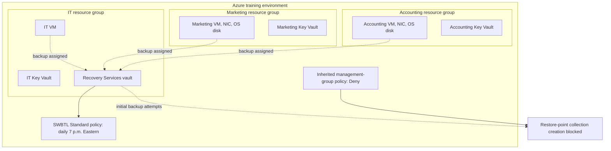

# Azure Cloud Security Lab

## Overview

I completed this Azure security lab for **D485 Cloud Security at Western Governors University** on **September 24, 2026**. The scenario involved improving resource organization, departmental access, Key Vault permissions, and VM backup configuration for the fictional company **SWBTL LLC**.

This is a student portfolio case study from a training environment. The outcome was corrected resource placement, scoped role assignments, saved vault access policies, and a configured backup schedule. **All three initial backups failed because an inherited lab policy denied a required restore-point resource. No successful recovery points or restore tests were demonstrated.**

## Problem and Objective

The scenario described an Azure migration with incomplete handover documentation, reported cross-department access, and uncertain backup protection. I reviewed the available configuration and corrected specific resource-placement and access-assignment issues. The lab did not prove the cause of every reported access concern or establish comprehensive isolation.

## Architecture

This is a resource-organization and backup-relationship diagram, not a network topology. It does not imply network isolation, private endpoints, or customer-managed-key integration. See [architecture and boundaries](docs/architecture.md).

## Work Performed

1. Moved the misplaced Accounting and Marketing Key Vaults into their corresponding resource groups.
2. Moved their VMs, network interfaces, and OS disks out of the IT resource group into the matching departmental groups.
3. Assigned each supplied departmental user **Reader** on its own resource group.
4. Assigned each departmental user **Key Vault Contributor** on its own vault.
5. Assigned the IT user **Backup Operator** on **Backup-Vault only**, removing an earlier eligible assignment at IT resource-group scope.
6. Saved vault access policies with **List** permissions for keys, secrets, and certificates for the matching departmental users.
7. Created the **SWBTL Standard Azure VM backup policy**: daily at **7 p.m. Eastern Time**, **three-day instant snapshot retention**, and **45-day daily recovery-point retention**.
8. Assigned all three VMs to that policy and attempted initial backups.

## Results

| Area | Observed outcome | Important qualification |
| --- | --- | --- |
| Resource placement | Departmental resources moved to matching groups | Resource groups are administrative boundaries, not network or application-data isolation |
| Azure roles | Department-scoped Reader and vault-scoped management roles recorded | Assignment views do not establish comprehensive negative-access testing |
| Key Vault | Departmental List access policies saved | Under the legacy model, vault contributors can change policies and grant themselves more data access |
| Backup configuration | Schedule, retention, and three VM policy assignments saved | Configuration does not establish successful protection |
| Initial backup attempts | All three VMs showed Failed and Critical | Inherited policy denied `Microsoft.Compute/restorePointCollections` with `RequestDisallowedByPolicy` |
| Recovery | Not demonstrated | No achieved RPO, RTO, successful recovery point, or restore claim |

The legacy Key Vault design needs a production redesign using Azure RBAC with separation between vault management and data access. List permissions do not establish workload encryption. These limits are discussed in [access decisions](docs/access-decisions.md) and [backup troubleshooting](docs/backup-troubleshooting.md).

## Evidence and Documentation

- [Selected screenshot gallery and evidence index](docs/evidence-index.md)
- [Access decisions and Key Vault permission limits](docs/access-decisions.md)
- [Backup configuration, failure analysis, and proposed verification](docs/backup-troubleshooting.md)
- [Limitations, recommendations, and lessons learned](docs/limitations-and-lessons.md)
- [Architecture and responsibility boundaries](docs/architecture.md)
- [Verified technical references](docs/references.md)

Seven selected screenshots are cropped and irreversibly masked to remove identity, subscription, and lab-instance details. Captions explain what each image supports and what it cannot prove. Original files remain private and unchanged.

## Skills Demonstrated

- Azure resource inventory and resource-group organization
- Scoped Azure role assignments and assignment review
- Key Vault control-plane and data-plane analysis
- Azure VM backup policy and retention configuration
- Policy-denial troubleshooting and escalation planning
- Evidence interpretation and accurate reporting of failed outcomes
- Shared-responsibility and least-privilege analysis

## Authorship and Assistance

**Beshoy Abdelmalak — student lab project.** The Azure implementation is described from my completed lab report and captured evidence. AI assistance was used to prepare this portfolio adaptation, organize the documentation, draft the explanatory diagram, redact selected evidence copies, and check references. No Azure changes, new tests, or successful recovery operations were performed while preparing this repository.

This repository contains a rewritten case study rather than the academic submission. It excludes the full report, original screenshot PDF and archive, rubric, proprietary course materials, instructor details, and credentials. Recommendations are identified separately from implemented work.
