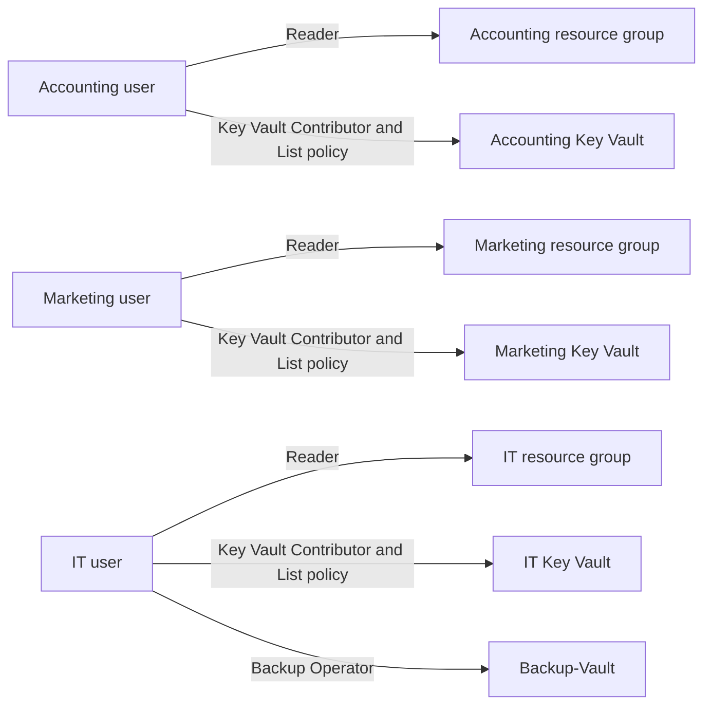

# Architecture and Responsibility Boundaries

## Recorded Resource Organization

The lab used three departmental resource groups. Accounting and Marketing each had a departmental VM, network interface, OS disk, virtual network, and Key Vault. Their misplaced vaults and VM-related resources were moved into the matching groups. The departmental virtual networks were already in the correct groups.

The IT group retained the IT workload, its vault, the Recovery Services vault, and a remaining storage account. In the source environment the IT vault used a finance-oriented name; this case study calls it **IT Key Vault** to make the departmental mapping clear. Other generated resource names and account suffixes are omitted.

Arrows represent configured access relationships. They do not establish negative-access results, a complete effective-permissions calculation, workload use of vault keys, or network paths. The inherited access-policy limitation is explained in [access decisions](access-decisions.md).

## Backup Relationships

The Recovery Services vault held the SWBTL Standard backup policy and registrations for all three VMs. The initial backup path was blocked when a required restore-point collection was denied by inherited policy. The diagram in the main README represents these assignments and the blocker, not working backup protection.

## Shared Responsibility

For the IaaS VMs, Azure operates the underlying physical infrastructure. The customer remains responsible for identities, data, guest operating systems, applications, and configured network controls. Managed services do not remove responsibility for permission choices, backup monitoring, or restore validation. See [Microsoft's shared-responsibility guidance](https://learn.microsoft.com/en-us/azure/security/fundamentals/shared-responsibility).

## Boundaries Not Demonstrated

- No validated segmentation or network-security remediation
- No customer-managed-key linkage between vaults and workloads
- No application TLS deployment or endpoint verification
- No complete user-to-department denial test matrix
- No successful backup or restore path

The architecture is intentionally conceptual. It does not reconstruct undisclosed addresses, subnets, interfaces, or trust relationships.
