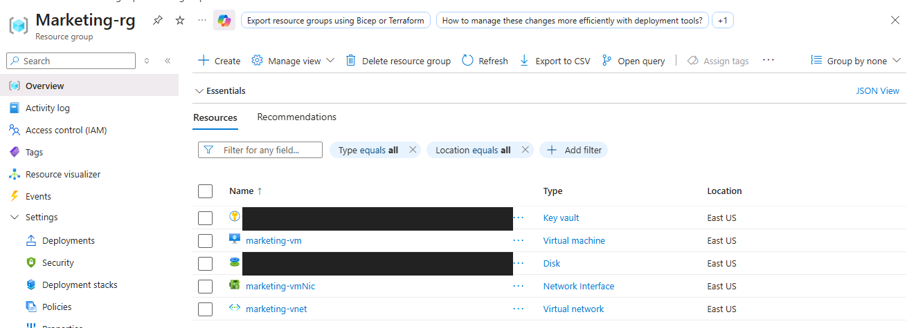
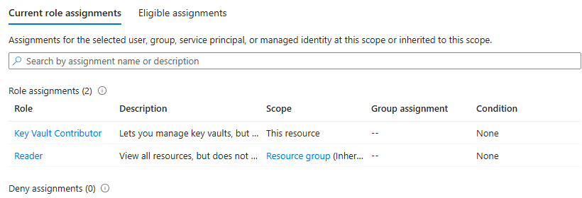
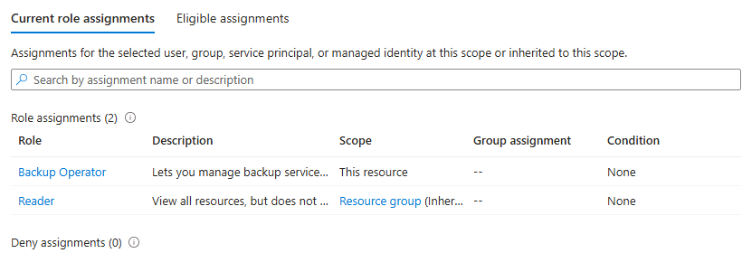
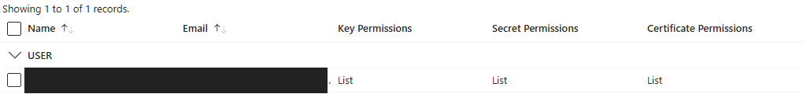
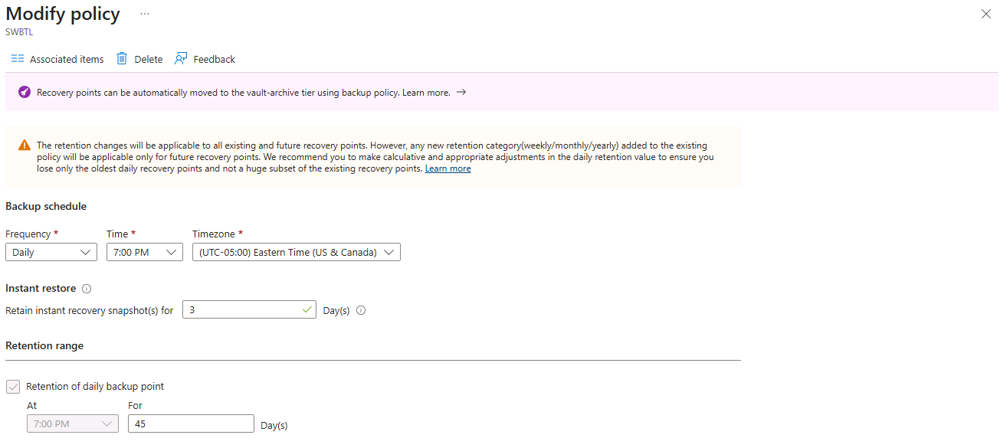
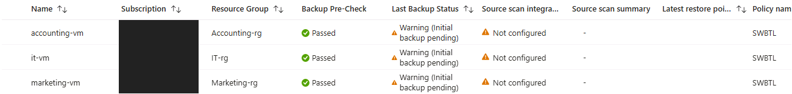
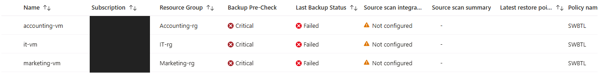

# Selected Evidence and Screenshot Gallery

## Reading This Evidence

These are seven selected excerpts from my private screenshot evidence PDF. They preserve the original UI content relevant to each claim. Browser chrome, signed-in identities, tenant and subscription details, generated resource identifiers, and workstation context were cropped out or covered by opaque masks in copies. No role, permission, schedule, or job-status value was synthesized or replaced.

The original sources remain unchanged. Account names in documentation are generic aliases. Because identity headers were removed from some excerpts, the association with a department or user comes from the private source figure and report, not from a visible identity in the crop.

## Evidence Index

| ID | Excerpt | Private evidence location | Supports | Does not establish |
| --- | --- | --- | --- | --- |
| E01 | Marketing resource placement | Figure 5, PDF page 6 | Marketing group contains vault, VM, disk, NIC, and VNet resource types | Every department's final placement or network isolation |
| E02 | Departmental vault assignments | Figure 14, PDF page 15 | Current Key Vault Contributor at resource scope and inherited Reader | All effective permissions, data operations, or denial to other departments |
| E03 | IT backup assignments | Figure 17, PDF page 18 | Backup Operator at resource scope plus inherited Reader | Removal history of the earlier eligible assignment or a successful restore |
| E04 | Marketing vault access policy | Figure 21, PDF page 22 | One saved policy with List for keys, secrets, and certificates | Workload encryption or an enforceable ceiling on a vault contributor |
| E05 | Backup policy form | Figure 25, PDF page 26 | Displayed schedule and retention settings | Save completion or successful jobs by itself |
| E06 | VM policy assignments | Figure 27, PDF page 28 | Three VMs assigned SWBTL; initial pre-check Passed and backup pending at capture | Successful recovery points |
| E07 | Failed initial backups | Figure 28, PDF page 29 | Critical and Failed on all three VM rows | Expanded error details or successful recovery |

### E01 — Departmental Resource Placement

Marketing resources appear in the matching resource group. Two generated names are masked. The report also records the Accounting moves; this selected image does not independently show them.

### E02 — Departmental Vault Assignment Scope

The source figure identifies the Accounting user at its vault. This crop retains the role and scope rows while removing the identity and vault-instance header. It is assignment evidence, not an executed access test.

### E03 — Vault-Scoped Backup Operator

The source figure identifies the IT user at Backup-Vault. The rows show current assignment scope. The report records removal of the earlier eligible resource-group assignment; this image does not show the removal event.

### E04 — Saved List Permissions

The selected Marketing policy visibly shows List in all three permission categories. It does not prove that the principal cannot later obtain more data access under the legacy access-policy model. The report records equivalent configuration for the other departments; the Accounting screenshot does not visibly confirm the certificate column as clearly, so it is not used as proof of all three values.

### E05 — Daily Schedule and Retention

The form displays the intended SWBTL settings. The private saved-policy list and report support that the policy was saved, and E06 shows the policy assigned to VM items. This form alone is not evidence that a backup ran.

### E06 — All Three VM Assignments

Accounting, IT, and Marketing appear with SWBTL in the policy column. The earlier pre-check status is Passed and the backup status is initial backup pending. The later result is shown in E07.

### E07 — Failed Initial Attempts

All three rows show Critical and Failed. The original archive filename suggested jobs in progress, but the screenshot's visible status is failure. No successful recovery point or restore is claimed.

## Additional Documentary Evidence

The following statements are supported by the private report and evidence package, not by new screenshots created for the portfolio:

- Initial placement and access configuration, and the recorded Accounting moves
- Removal of the earlier eligible IT resource-group Backup Operator assignment
- Saved policy-list entry and departmental access-policy configuration
- The detailed `RequestDisallowedByPolicy` failure and blocked `Microsoft.Compute/restorePointCollections` type

The failure detail is a written transcription in Evidence Note 1, PDF page 31. The Activity log overview in Figure 29, page 30, shows failed operations but does not display the expanded policy error. Neither source is a successful recovery result.

## Evidence Handling

Only the seven reviewed PNGs are included. The full PDF, report, edited text, original screenshot archive, identity exports, and review files remain private. Opaque pixel masks are burned into fresh RGB PNG copies, with original image metadata discarded. The gallery contains no editable redaction layer or embedded original screenshot.

Source provenance is retained by figure and page reference. Public filenames describe visible results rather than relying on potentially misleading source filenames.
